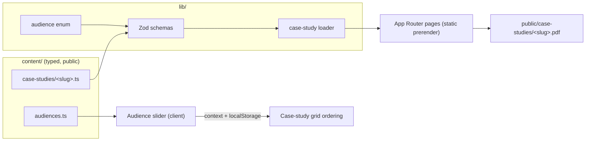

# software-dev-portfolio

My developer portfolio: case studies of things I've built, written so a recruiter, a hiring manager,
a fellow developer, a friend, or a potential business partner can each get what they need quickly.

The source is public on purpose. How a site is built says as much as what it says.

> **Status:** the site shell, audience slider and case-study pages are live with **placeholder**
> content. Real case studies and the optional AI chat assistant are the next phases.

## What's here

| Route                  | What it does                                                                                                 |
| ---------------------- | ------------------------------------------------------------------------------------------------------------ |
| `/`                    | Hero with the audience slider, featured case studies, links out                                              |
| `/case-studies`        | Card grid, ordered and highlighted for the selected audience                                                 |
| `/case-studies/[slug]` | Problem, role, approach, stack and outcome, a "30-second / full story" toggle, and a PDF download            |
| `/contact`             | Contact form: a role, a project, or anonymous feedback on the site                                           |
| `/chat`                | _(planned)_ An optional assistant that answers only from the public content. The site works fully without it |

## Architecture



- **Next.js App Router** with Cache Components. Every page is prerendered at build time.
- **Content as code.** Each case study is a typed file validated by a Zod schema when the app
  builds, so a typo in content fails the build instead of shipping. A unit test also checks every
  case study's PDF exists.
- **Design tokens.** Colours come from my Canvas design system as CSS variables, mapped to semantic
  Tailwind names (`bg-surface`, `text-secondary`, ...). The default Tailwind palette is removed, so
  components can't use raw colours. A unit test checks WCAG AA contrast for text in both themes,
  including on each audience's tinted hero background (the canvas mixed towards that audience's
  accent with CSS `color-mix`).
- **Light and dark** via `next-themes`.
- **Page transitions** are pure CSS keyframes on Next.js `template.tsx` files: a soft fade-and-rise
  between top-level pages, and a short slide-in when opening a case study. There's no JavaScript
  involved, content is never hidden waiting for hydration, and they're off under
  `prefers-reduced-motion`.
- **Contact form.** react-hook-form with the same Zod schema on the client and in a Server Action,
  which re-validates everything. Messages go out as plain text through Resend's REST API, with the
  destination address and key in env vars (not in this repo). Spam control is a honeypot field plus a
  minimum fill time; bots get a convincing "sent" and nothing is delivered. Site feedback can be
  anonymous.

## The audience slider

The hero has a five-stop slider: _Recruiter → Hiring manager → Fellow developer → Friend or family →
Business partner_. Every move from one stop to the next sweeps a vertical divider across the full
width of the hero, wiping from one audience's copy to the next. Drag past several stops and you get
one full sweep per stop. Release and it snaps to the nearest stop. The choice then reorders and
highlights the case studies and persists across the site.

How it works:

- A single Framer Motion `motionValue` holds the thumb position. The wipe is derived from it: between
  two adjacent stops, the divider's x is how far the thumb has travelled between them (0–100% of the
  width). Left of the divider shows the higher stop's audience, right shows the lower one. So
  dragging right reveals the next audience from the left, dragging left reveals it from the right,
  and resting on a stop is never half-revealed.
- Taps and key presses animate the thumb at a steady pace per stop, so a jump from Recruiter to
  Business partner plays four sweeps in a row.
- The stop maths (progress ↔ index, progress → segment and sweep fraction, pointer → progress,
  key → index) is plain TypeScript in `lib/slider.ts`, unit tested separately from React.
- **Accessible:** the thumb is `role="slider"` with `aria-valuenow`/`aria-valuetext`. Arrow keys,
  Home and End move between stops, and focus is visible. With `prefers-reduced-motion` the sweep is
  skipped and the content swaps instantly.
- **Touch-friendly:** pointer events with `touch-action: pan-y`, so a horizontal drag moves the
  slider while a vertical swipe still scrolls the page. The thumb is a 44px target.
- **Audiences are data.** Each is one entry in `content/audiences.ts` (id, label, accent, default
  contact topic, copy, featured case studies), validated by a Zod schema at build time and shared
  by the UI, the case-study ordering, the contact form and the planned chat assistant. Adding or
  removing an audience is a one-entry change. The slider adapts to 2–6 stops, and visitors whose
  saved audience is removed fall back to the first one.

## How the chatbot is kept safe and cheap _(planned, phase 4)_

The chat assistant is optional and isolated (`components/chat/`, `app/api/chat/`). The design
assumes the model can be tricked, so there's nothing harmful to gain and spending is capped:

- **Nothing private to leak.** It only knows `content/public/` (bio, case studies, FAQ), all
  written for public reading. It has no tools and no access to other repos, files, email or memory.
  The system prompt is in this repo and holds no secrets.
- **Narrow scope.** It answers about my work, skills and availability, declines everything else,
  says "I don't know" rather than guessing, and never claims to be human.
- **Cost caps.** Suggested-question chips return canned answers with zero API calls. Free-text
  questions get Zod-enforced input limits, truncated history and a small `max_tokens`. Upstash Redis
  rate-limits per visitor and enforces a global daily budget. On top of that, the API key lives in a
  separate Anthropic workspace with a hard monthly spend limit.
- **Locked down.** Same-origin check on the endpoint, plain-text rendering (no raw HTML), and no
  long-term storage of messages or IPs.
- **Tested adversarially.** A Promptfoo eval suite covers prompt injection, jailbreak role-play,
  requests for private data, off-topic requests and hallucination probes.

## Running it

Requires Node 22+.

```bash
npm install
npm run dev            # http://localhost:3000
```

## Tests

```bash
npm run lint           # ESLint
npm run typecheck      # route types + tsc
npm test               # Vitest: schemas, slider maths, loader, PDF presence, colour contrast, components
npm run e2e            # Playwright: builds and serves the site, then runs desktop + mobile suites
E2E_BASE_URL=https://<preview-url> npm run e2e   # same suite against a deployed site
```

The Playwright suite drags the slider with a mouse and asserts the divider moves. It also covers
keyboard navigation, touch drag on an emulated phone, reduced motion, every case-study page and its
PDF, the theme toggle, and horizontal overflow at 360px.

CI (GitHub Actions) runs lint, format check, typecheck and unit tests, then Playwright against a
local production build. A second workflow runs Playwright against each successful Vercel preview
deployment.
