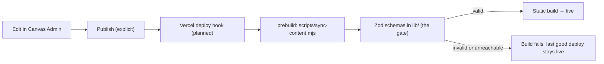

# Where the content comes from

> **Status:** the build-time sync is built and tested against Canvas's dev API. Production
> still uses the committed content until Vercel is set up with the settings below, and
> publishing doesn't trigger a rebuild yet.

Case studies, audiences and (later) skills are edited in **Canvas**, Cam's private personal
platform, and pulled into this site **at build time**. The site stays fully static, with no
runtime dependency on Canvas.

## Rules

- **Only published content.** Drafts never leave Canvas; publishing is an explicit action.
- **This repo's Zod schemas are the final gate.** Anything that doesn't validate fails the build,
  and Vercel keeps serving the previous deployment. There's no silent fallback.
- **A versioned contract.** The snapshot carries a `schemaVersion`, and the site refuses versions
  it doesn't understand. `contract/portfolio-snapshot.schema.json` is generated from the Zod
  schemas (a unit test fails if it drifts; `UPDATE_CONTRACT=1 npm test` regenerates it). Canvas
  keeps a copy and validates every publish against it, so re-copy it there after changing it.
- **PDFs are copied into the build** so downloads stay on this domain. Each one is checked
  against the sha256 in the snapshot.
- **Content only.** Site structure (contact topics, navigation, accent palette) stays in code.

## How it works

`scripts/sync-content.mjs` runs before `npm run dev` and `npm run build` (`predev` / `prebuild`).
It always rebuilds `public/case-studies/` (gitignored) from scratch.

| `PORTFOLIO_CONTENT_SOURCE` | Used by                       | What the sync does                                                                                    |
| -------------------------- | ----------------------------- | ----------------------------------------------------------------------------------------------------- |
| `local` (default)          | dev, unit tests, CI, e2e      | Copies the fixture PDFs from `content/case-studies/pdfs/`. Content comes from the files in `content/` |
| `canvas`                   | Vercel production and preview | Fetches the published snapshot and its PDFs, writes the gitignored `content/generated/portfolio.json` |

The app imports content from one alias, `@content-source`. `next.config.ts` points it at
`content/local.ts` or `content/generated/portfolio.json` depending on the source. TypeScript and
Vitest always resolve it to the local fixtures, so tests never call Canvas.

In `canvas` mode the sync fails the build if Canvas is unreachable or returns an error, if the
schema version is unsupported, or if any PDF is missing or fails its integrity check.

## Settings

| Variable                   | Where                      | Purpose                                            |
| -------------------------- | -------------------------- | -------------------------------------------------- |
| `PORTFOLIO_CONTENT_SOURCE` | Vercel (`canvas`)          | Which source to build from                         |
| `CANVAS_API_URL`           | Vercel                     | Base URL of the Canvas web API                     |
| `PORTFOLIO_READ_KEY`       | Vercel (secret, encrypted) | Read-only key; only unlocks the published snapshot |

To try a Canvas build locally, set the three variables and run `npm run build`.
