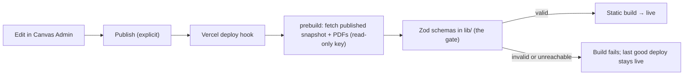

# Where the content comes from

> **Status:** planned. Today the site still reads the committed files in `content/`.

Case studies, audiences and (later) skills will be edited in **Canvas**, Cam's private personal
platform, and pulled into this site **at build time**. The site stays fully static, with no
runtime dependency on Canvas.

## Rules

- **Only published content.** Drafts never leave Canvas; publishing is an explicit action.
- **This repo's Zod schemas are the final gate.** Anything that doesn't validate fails the build,
  and Vercel keeps serving the previous deployment. There's no silent fallback.
- **A versioned contract.** The snapshot carries a `schemaVersion`, and the site refuses versions
  it doesn't understand. The schemas are exported as JSON Schema so Canvas can test against
  them.
- **PDFs are copied into the build** so downloads stay on this domain.
- **Content only.** Site structure (contact topics, navigation, accent palette) stays in code.

## Sources

| `PORTFOLIO_CONTENT_SOURCE` | Used by                       | Content                                                                      |
| -------------------------- | ----------------------------- | ---------------------------------------------------------------------------- |
| `local` (default)          | dev, unit tests, CI, e2e      | The committed files in `content/` (fixtures)                                 |
| `canvas`                   | Vercel production and preview | Fetched by the prebuild script; written to a gitignored `content/generated/` |

The read key lives only in Vercel's environment variables.
